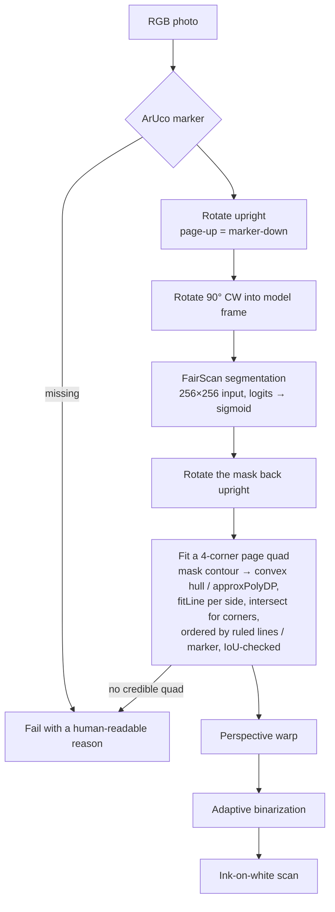
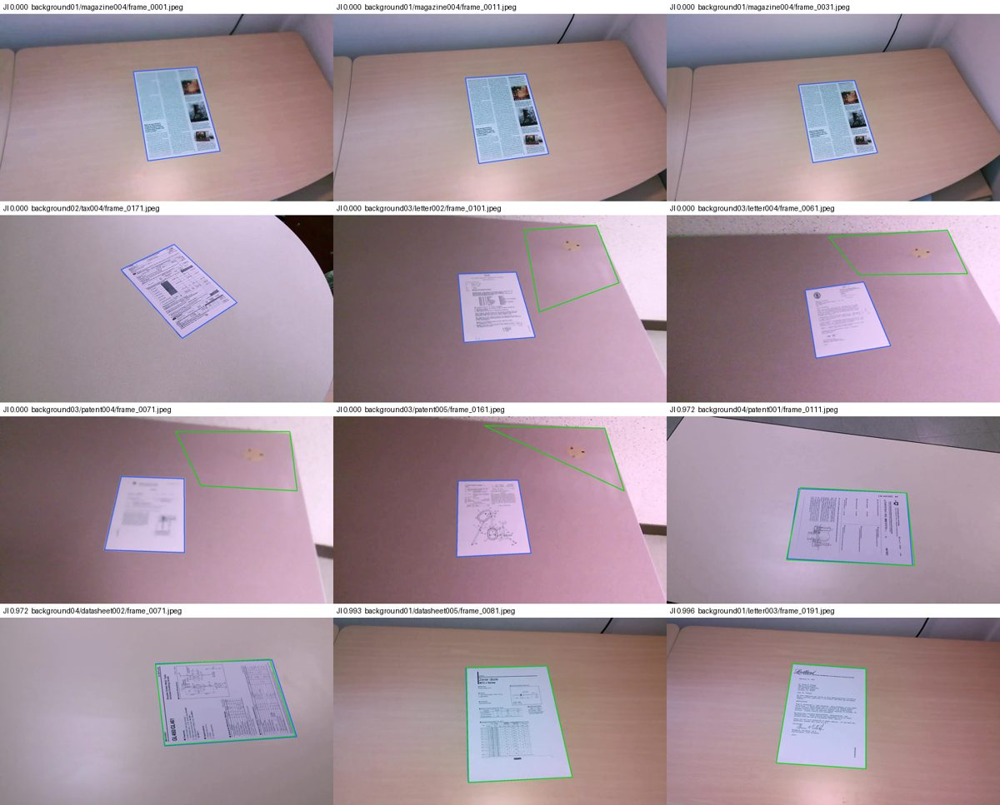

# MissileNotes

[](../../actions/workflows/ci.yml)
[](LICENSE)

MissileNotes turns a photo of a paper page into a flat, upright, black-ink-on-white
scan. Print an [ArUco](https://en.wikipedia.org/wiki/ArUco) marker, stick it on a
page corner, and photograph the page. The marker gives the pipeline a known anchor:
it says which way is up, which side of the page is which, and where the page
outline should be, so a handheld photo can be corrected without a tripod or a
flatbed. The goal is an iPhone + Android app with on-device scanning, cloud sync,
and optional AI cleanup; the only setup should be a printed marker.

## Status

Early, but end-to-end. `missilenotes/` is a tested Python reference package that
does the whole scan. `app/` is the Flutter iOS + Android project with a Dart
port of the pipeline and parity fixtures, plus a capture flow: take or pick a
photo, scan it on-device, view the result, and share it. It has not yet been
run on a physical phone. Page detection is benchmarked on real phone frames from
the public SmartDoc dataset (see [Benchmark](#benchmark)); there are no real
notebook photos in this repository yet.

## Pipeline



The marker is required. If it is missing, the pipeline stops before running the
model rather than guessing at a page.

## Benchmark

Page detection is scored on [ICDAR'15 SmartDoc Challenge 1](https://github.com/jchazalon/smartdoc15-ch1-dataset):
24,889 phone-video frames of 30 printed documents on 5 backgrounds, each with
ground-truth page corners. The metric is the competition's Jaccard index (JI),
computed in each document's own reference frame; a failed scan scores 0.
Every 10th frame is used (2,555 frames).

SmartDoc has no ArUco marker, so two modes run on the same frames:

- **No marker** — `scan(rotation=...)` takes the upright rotation from the
  ground truth (the only thing the marker normally supplies); the page quad
  comes from segmentation and geometry alone.
- **Composited marker** — a real `DICT_6X6_50` marker (30 mm, upside-down) is
  warped onto the page's top-right corner with the ground-truth homography and
  the unmodified pipeline runs. A pasted marker is sharper than a printed one,
  so this mode is optimistic about detection.

| mode | mean JI | median JI | failed | bg 1 | bg 2 | bg 3 | bg 4 | bg 5 |
|---|---|---|---|---|---|---|---|---|
| no marker | 0.905 | 0.972 | 1.8% | 0.964 | 0.967 | 0.926 | 0.966 | 0.478 |
| composited marker | 0.897 | 0.971 | 4.3% | 0.962 | 0.961 | 0.928 | 0.961 | 0.429 |

Published results for reference (Table III of
[Tropin et al. 2020](https://arxiv.org/abs/2008.02615), full frame set):

| method | bg 1 | bg 2 | bg 3 | bg 4 | bg 5 | all |
|---|---|---|---|---|---|---|
| JCD+CSR | 0.988 | 0.984 | 0.983 | 0.984 | 0.961 | 0.982 |
| LRDE-3 | 0.985 | 0.982 | 0.987 | 0.980 | 0.848 | 0.970 |
| Smart Engines | 0.989 | 0.983 | 0.990 | 0.979 | 0.688 | 0.955 |
| GOP | 0.961 | 0.944 | 0.965 | 0.930 | 0.412 | 0.896 |
| SmartDoc competition average | 0.947 | 0.903 | 0.938 | 0.812 | 0.404 | 0.855 |

What the numbers say:

- On backgrounds 1, 2 and 4 the mean JI (0.964–0.967) is within 0.025 of the
  best published method, using a general-purpose 256×256 segmentation model
  with no SmartDoc-specific training. Typical frames are better than the
  mean: the overall median is 0.972.
- Background 5 (cables, pens and a highlighter across the page, other sheets
  stacked beneath it) is the weak spot, as it is for most published methods.
- Most remaining failures are the model merging a pale desk with the page, or
  choosing a glare patch over the page on background 3 (the green outline in
  the sheet below). With a marker the pipeline keeps the mask island under the
  marker, which is why the marker mode wins on background 3.
- The benchmark found a real bug. Hough also detects phantom 45° diagonals
  through tables and forms, and those could override the marker's page angle,
  which collapses corner ordering. Ruled lines may now only refine the marker
  (or image-axes) angle by up to 20°. Before that fix the composited-marker
  mode scored 0.837 mean JI with 10.6% failed scans; the no-marker mode
  scored 0.873.



Reproduce (about 1 GB download, ~13 minutes on 3 CPU cores):

```bash
.venv/bin/python scripts/smartdoc.py fetch
.venv/bin/python scripts/smartdoc.py run --step 10 -o eval_out/smartdoc
```

`run` writes `results.csv` (per frame and mode), `summary.md` (by background,
document type and failure reason) and a contact sheet per mode. SmartDoc is
printed pages lying flat, not spiral-notebook pages, so it measures page
detection, not notebook-specific behaviour. It is used as a held-out test set:
nothing is tuned against it.

SmartDoc is CC BY 4.0: Burie et al., "ICDAR2015 Competition on Smartphone
Document Capture and OCR (SmartDoc)", ICDAR 2015. The contact sheet above is
derived from its frames.

## Quickstart

The model weights are in Git LFS. Install LFS first; otherwise you get pointer
files instead of weights.

```bash
git lfs install
git lfs pull
uv venv
uv pip install -e ".[tflite,dev]"
.venv/bin/python -m missilenotes scan path/to/photo.jpg -o out --debug
```

`scan` accepts images, HEIC/HEIF included, or a directory of images. It writes
`<stem>_scan.png` into the output directory; `--debug` also writes
`<stem>_debug.png` with the marker, mask and fitted quad drawn on the photo. Add
`--no-binarize` to keep the flat grayscale page instead. The default weights are
the horizontal TFLite model at
`experiments/model_horizontal/fairscan-segmentation-model.tflite`; use
`--weights` to point somewhere else.

For the PyTorch backend, install `.[torch,dev]` and pass the matching `.pt` file.
For a folder-level report, run:

```bash
.venv/bin/python scripts/eval.py path/to/photos -o eval_out
```

That writes a `results.csv` of per-stage timings and a visual
`contact_sheet.png`.

## Scan options

Two optional cleanup stages are off by default, so the plain `scan` output is
unchanged. `--normalize` flattens uneven lighting and cast shadows before
binarizing: it estimates the paper with an edge-preserving median and divides
the page by it. `--remove-rules` clears printed ruled and margin lines from the
binarized scan using long/thin shapes plus rule-colour (blue/red) detection; it
keeps dark handwriting, including strokes crossing a rule, and is ignored with
`--no-binarize`.

```bash
.venv/bin/python -m missilenotes scan photo.jpg -o out --normalize --remove-rules
```

## Python API

```python
import numpy as np
from PIL import Image

from missilenotes import scan
from missilenotes.segment import Segmenter

image = np.asarray(Image.open("photo.jpg").convert("RGB"))
segmenter = Segmenter(
    "experiments/model_horizontal/fairscan-segmentation-model.tflite"
)
result = scan(image, segmenter)

if result.ok:
    Image.fromarray(result.scan).save("scan.png")
else:
    print(result.reason, result.confidence)
```

`scan` returns a `ScanResult` with `scan` (binarized uint8), `flat_rgb`, the
fitted `quad` in original-photo coordinates, the `rotation` it applied, a
`confidence` (quad/mask IoU), and per-stage `timings`. The caller injects the
segmenter, so tests and other backends can supply anything with
`predict(img_rgb) -> HxW probability`.

`scan(..., rotation=deg)` skips marker detection and uses that CCW rotation
(a multiple of 90) instead. It exists for marker-free benchmarks; the default
keeps the marker required.

## Editor for bad scans

`tools/warp_editor.py` is a small Tk fallback for scans the automatic pipeline
got wrong. The initial quad comes from `scan()`; drag its four corners, preview
the flattened page, and save it.

```bash
.venv/bin/python -m tools.warp_editor photo1.heic photo2.jpg
```

Keys: drag corners, `Enter`/`Space` preview, `b` toggle binarized/grayscale,
Left/Right change photo, `s` save `<stem>_scan.png` next to the original. A
failed scan starts from a whole-image rectangle so it can be corrected by hand.

## Mobile app

`app/` is the Flutter project for iOS and Android. `app/lib/pipeline/` is a
Dart port of the reference stages (`marker`, `geometry`, `enhance`, `segment`,
`pipeline`) built on `opencv_dart` and `tflite_flutter`, using the same
horizontal `.tflite` weights. `app/test/fixtures/` holds parity fixtures
generated by `scripts/export_fixtures.py`; the Dart tests compare their output
with the Python pipeline. The port currently covers the core scan path; the
`--normalize` and `--remove-rules` stages are Python-only for now.

```bash
cd app
flutter pub get
flutter analyze
flutter test --concurrency=1
```

On Linux one test is skipped by design: `flutter_tester` has no host TFLite
library, so the real-model parity test cannot load LiteRT. To run on an iPhone
from a Mac, connect the device and run `cd app && flutter run`. Building for a
physical device needs code signing: open `app/ios/Runner.xcworkspace` in Xcode
and add your Apple ID/team under Signing & Capabilities.

## Mobile port contract

The package is deliberately numpy-in/numpy-out; the mobile app should keep the
same stage order.

**Model I/O.** The horizontal FairScan model in `experiments/model_horizontal/`
is the one in use. Both backends take a 256×256 RGB image:

- PyTorch `.pt`: NCHW float32 `1×3×256×256`, values `[0, 1]`, then ImageNet
  mean `[0.485, 0.456, 0.406]` / std `[0.229, 0.224, 0.225]`. Output is
  `1×1×256×256` raw **logits**; sigmoid is applied in Python.
- TFLite `.tflite`: NHWC float32 `1×256×256×3`, both tensors plain float32.
  The graph contains **no normalization and no sigmoid**; the app must apply
  the same ImageNet normalization before inference and the sigmoid afterwards.
  The graph pins the input to 256×256.
- The output logits are resized back to the input image resolution (bicubic),
  sigmoided and clipped to `[0, 1]`. The mask is thresholded at 0.5.

The old experiments fed 512×512 into the same weights. That produced a
materially different mask from the 256×256 TFLite graph; 256 is both the
portable contract and what makes the two backends agree.

**Rotation bookkeeping.** Detect the marker once, on the original photo. Rotate
the photo by `upright_rotation(marker)` (CCW; page-up is marker-down), then turn
another 90° clockwise into the horizontal model's frame. Undo that turn (90° CCW)
on the mask before geometry. Keep every point — marker corners, page quad, mask —
in one frame by rotating coordinates with `rotate_points`; do not re-detect the
marker after rotating.

**What each stage needs.** Marker: ArUco `DICT_6X6_50` detection. Geometry:
clean mask contours, a convex hull plus `approxPolyDP` (with a `minAreaRect`
fallback) to seed four corners, a robust `fitLine` (`DIST_HUBER`) per side,
intersecting adjacent lines for sub-pixel corners, Canny + Hough to order the
corners in page axes, a perspective transform, and an IoU check against the
mask. The marker can only push its nearest corner outward. Warp output size
averages opposite sides. Enhance: a local adaptive threshold plus
connected-component speck removal. Everything upstream of those primitives is
plain numpy.

Rough CPU timing on synthetic photos in this worktree: about 0.3 s for the
whole pipeline, of which model inference is about 0.15–0.2 s. No mobile
measurements exist yet.

## Testing

```bash
.venv/bin/python -m pytest -q
```

`tests/synth.py` renders synthetic notebook pages: paper, rules, a margin,
handwriting, a real upside-down ArUco marker, a projective placement, uneven
lighting, blur and noise, plus a deliberately imperfect model-like mask. Tests
cover marker detection, rotation bookkeeping, quad recovery in original-photo
coordinates, the CLI/eval output paths, the model tensor contract, and
PyTorch/TFLite agreement. Tests that need a runtime or the LFS weights skip
cleanly when those are absent.

What is **not** verified: real photographs, keystone beyond ~20% or real-camera
lens distortion, different papers and inks, low light, motion blur, or on-device
performance. There are no accuracy claims in this README because there is no
real-photo eval set yet.

## Project layout

```
missilenotes/        Reference package
  marker.py          ArUco detection, upright rotation, point rotation
  geometry.py        Mask cleanup, page quad fitting, perspective warp
  enhance.py         Adaptive binarization + speck removal
  segment.py         FairScan .pt/.tflite wrapper (256×256 contract)
  pipeline.py        scan(), ScanResult, debug_overlay()
  __main__.py        python -m missilenotes scan ...
app/                 Flutter iOS/Android app (Dart pipeline port + tests)
scripts/eval.py      Folder eval → results.csv + contact sheet
scripts/export_fixtures.py  Python-generated parity fixtures for app/test/
tools/warp_editor.py Tk hand-correction editor
tests/               pytest suite and the synthetic page generator
.github/workflows/   CI: Python tests, Flutter analyze/test, iOS build
experiments/model*/  FairScan weights (.pt + .tflite, Git LFS) and licenses
experiments/data/    Printable marker (aruco.png / aruco.svg); scans are ignored
```

`experiments/` now only holds the model weights and the printable marker; the
old prototype scripts were replaced by `missilenotes/`.

## Roadmap

1. **Notebook eval set** — SmartDoc covers printed pages; spiral-notebook
   photos (coil, perforations, page curl) still need their own labelled set.
2. **Mobile app** — wire the existing Dart pipeline to iOS/Android camera
   capture, on-device `.tflite` inference, and a scan library UI.
3. **Cloud sync** — upload scans and keep a searchable library across devices.
4. **AI cleanup** — optional handwriting/ink cleanup and background removal on
   top of the geometric scan.

## License

The bundled FairScan weights are **GPL-3.0** (see
`experiments/model_horizontal/LICENSE.txt` and `experiments/model/LICENSE.txt`).
Any app that ships those weights must be GPL-compatible and provide the
corresponding source. If that is not acceptable, swap in separately licensed
weights. Because the weights are required, this repository as a whole is
**GPL-3.0**; see [`LICENSE`](LICENSE) for the full text.
