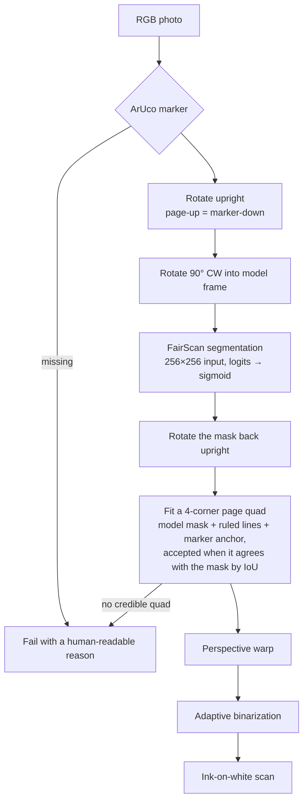

# MissileNotes

MissileNotes turns a photo of a paper page into a flat, upright, black-ink-on-white
scan. Print an [ArUco](https://en.wikipedia.org/wiki/ArUco) marker, stick it on a
page corner, and photograph the page. The marker gives the pipeline a known anchor:
it says which way is up, which side of the page is which, and where the page
outline should be, so a handheld photo can be corrected without a tripod or a
flatbed. The goal is an iPhone + Android app with on-device scanning, cloud sync,
and optional AI cleanup; the only setup should be a printed marker.

## Status

Early, but end-to-end. `missilenotes/` is a tested Python reference package that
does the whole scan; a mobile app does not exist yet. Everything is verified on
synthetic pages only — there are no real photos in this repository and no
real-world accuracy numbers. Platform work is still ahead, and the quad fitting
step is being generalized to handle handheld keystone (a page photographed as a
general quadrilateral, not a rough rectangle).

## Pipeline



The marker is required. If it is missing, the pipeline stops before running the
model rather than guessing at a page.

## Quickstart

The model weights are in Git LFS. Install LFS first; otherwise you get pointer
files instead of weights.

```bash
git lfs install
git lfs pull
uv venv
uv pip install -e ".[tflite,dev]"
.venv/bin/python -m missilenotes scan path/to/photo.jpg -o out --debug
```

`scan` accepts images, HEIC/HEIF included, or a directory of images. It writes
`<stem>_scan.png` into the output directory; `--debug` also writes
`<stem>_debug.png` with the marker, mask and fitted quad drawn on the photo. Add
`--no-binarize` to keep the flat grayscale page instead. The default weights are
the horizontal TFLite model at
`experiments/model_horizontal/fairscan-segmentation-model.tflite`; use
`--weights` to point somewhere else.

For the PyTorch backend, install `.[torch,dev]` and pass the matching `.pt` file.
For a folder-level report, run:

```bash
.venv/bin/python scripts/eval.py path/to/photos -o eval_out
```

That writes a `results.csv` of per-stage timings and a visual
`contact_sheet.png`.

## Python API

```python
import numpy as np
from PIL import Image

from missilenotes import scan
from missilenotes.segment import Segmenter

image = np.asarray(Image.open("photo.jpg").convert("RGB"))
segmenter = Segmenter(
    "experiments/model_horizontal/fairscan-segmentation-model.tflite"
)
result = scan(image, segmenter)

if result.ok:
    Image.fromarray(result.scan).save("scan.png")
else:
    print(result.reason, result.confidence)
```

`scan` returns a `ScanResult` with `scan` (binarized uint8), `flat_rgb`, the
fitted `quad` in original-photo coordinates, the `rotation` it applied, a
`confidence` (quad/mask IoU), and per-stage `timings`. The caller injects the
segmenter, so tests and other backends can supply anything with
`predict(img_rgb) -> HxW probability`.

## Editor for bad scans

`tools/warp_editor.py` is a small Tk fallback for scans the automatic pipeline
got wrong. The initial quad comes from `scan()`; drag its four corners, preview
the flattened page, and save it.

```bash
.venv/bin/python -m tools.warp_editor photo1.heic photo2.jpg
```

Keys: drag corners, `Enter`/`Space` preview, `b` toggle binarized/grayscale,
Left/Right change photo, `s` save `<stem>_scan.png` next to the original. A
failed scan starts from a whole-image rectangle so it can be corrected by hand.

## Mobile port contract

The package is deliberately numpy-in/numpy-out; the mobile app should keep the
same stage order.

**Model I/O.** The horizontal FairScan model in `experiments/model_horizontal/`
is the one in use. Both backends take a 256×256 RGB image:

- PyTorch `.pt`: NCHW float32 `1×3×256×256`, values `[0, 1]`, then ImageNet
  mean `[0.485, 0.456, 0.406]` / std `[0.229, 0.224, 0.225]`. Output is
  `1×1×256×256` raw **logits**; sigmoid is applied in Python.
- TFLite `.tflite`: NHWC float32 `1×256×256×3`, both tensors plain float32.
  The graph contains **no normalization and no sigmoid**; the app must apply
  the same ImageNet normalization before inference and the sigmoid afterwards.
  The graph pins the input to 256×256.
- The output logits are resized back to the input image resolution (bicubic),
  sigmoided and clipped to `[0, 1]`. The mask is thresholded at 0.5.

The old experiments fed 512×512 into the same weights. That produced a
materially different mask from the 256×256 TFLite graph; 256 is both the
portable contract and what makes the two backends agree.

**Rotation bookkeeping.** Detect the marker once, on the original photo. Rotate
the photo by `upright_rotation(marker)` (CCW; page-up is marker-down), then turn
another 90° clockwise into the horizontal model's frame. Undo that turn (90° CCW)
on the mask before geometry. Keep every point — marker corners, page quad, mask —
in one frame by rotating coordinates with `rotate_points`; do not re-detect the
marker after rotating.

**What each stage needs.** Marker: ArUco `DICT_6X6_50` detection. Geometry:
contours and point-in-polygon, Canny + Hough line segments for the page angle,
robust percentiles for extent, a perspective transform, and an IoU check against
the mask. Enhance: a local adaptive threshold plus connected-component speck
removal. Everything upstream of those primitives is plain numpy.

Rough CPU timing on synthetic photos in this worktree: about 0.3 s for the
whole pipeline, of which model inference is about 0.15–0.2 s. No mobile
measurements exist yet.

## Testing

```bash
.venv/bin/python -m pytest -q
```

`tests/synth.py` renders synthetic notebook pages: paper, rules, a margin,
handwriting, a real upside-down ArUco marker, a projective placement, uneven
lighting, blur and noise, plus a deliberately imperfect model-like mask. Tests
cover marker detection, rotation bookkeeping, quad recovery in original-photo
coordinates, the CLI/eval output paths, the model tensor contract, and
PyTorch/TFLite agreement. Tests that need a runtime or the LFS weights skip
cleanly when those are absent.

What is **not** verified: real photographs, general handheld keystone, different
papers and inks, low light, motion blur, or on-device performance. There are no
accuracy claims in this README because there is no real-photo eval set yet.

## Project layout

```
missilenotes/        Reference package
  marker.py          ArUco detection, upright rotation, point rotation
  geometry.py        Mask cleanup, page quad fitting, perspective warp
  enhance.py         Adaptive binarization + speck removal
  segment.py         FairScan .pt/.tflite wrapper (256×256 contract)
  pipeline.py        scan(), ScanResult, debug_overlay()
  __main__.py        python -m missilenotes scan ...
scripts/eval.py      Folder eval → results.csv + contact sheet
tools/warp_editor.py Tk hand-correction editor
tests/               pytest suite and the synthetic page generator
experiments/model*/  FairScan weights (.pt + .tflite, Git LFS) and licenses
experiments/data/    Printable marker (aruco.png / aruco.svg); scans are ignored
```

`experiments/` now only holds the model weights and the printable marker; the
old prototype scripts were replaced by `missilenotes/`.

## Roadmap

1. **Real-photo eval set** — collect marked notebook photos, label page
   corners, and measure geometry and scan quality instead of relying on
   synthetic pages.
2. **Mobile app** — iOS and Android camera capture, on-device `.tflite`
   inference, and the same marker/rotation/quad stages.
3. **Cloud sync** — upload scans and keep a searchable library across devices.
4. **AI cleanup** — optional handwriting/ink cleanup and background removal on
   top of the geometric scan.

## License

The bundled FairScan weights are **GPL-3.0** (see
`experiments/model_horizontal/LICENSE.txt` and `experiments/model/LICENSE.txt`).
Any app that ships those weights must be GPL-compatible and provide the
corresponding source. If that is not acceptable, swap in separately licensed
weights. The source in this repository does not carry its own `LICENSE` file
yet.
